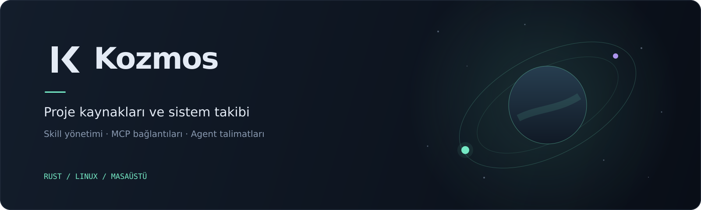

# Kozmos

Kozmos, bir projenin **skill dosyalarını, MCP yapılandırmalarını ve agent talimatlarını** görüntülemek ve düzenlemek için geliştirilen Rust masaüstü uygulamasıdır. Proje dashboardında sistem kullanımını canlı takip edebilirsiniz.

Linux üzerinde [egui / eframe](https://github.com/emilk/egui) ile çalışır; arayüz için tarayıcı gerektirmez.

## Özellikler

- **Kaynak yönetimi:** Skill, MCP ve talimat dosyalarını listeleme, arama, oluşturma ve düzenleme; skill dosyalarını etkinleştirme veya devre dışı bırakma.
- **MCP bağlantı testi:** stdio ve Streamable HTTP sunucularında bağlantı, sunucu kimliği ve araç listesi kontrolü.
- **Proje görünümü:** Mevcut projenin adı, dizini, kaynak sayıları ve proje içi özel kaynak ayarları.
- **Sistem takibi:** CPU, RAM, disk, ağ, çalışma süresi ve belleğe göre ilk altı süreç; CPU ve bellek için son 90 örneğin grafikleri.
- **Dashboard araçları:** 25 dakikalık odak sayacı, CSV dışa aktarma ve hareketi durdurulabilen uzay bannerı.

## Gereksinimler

- Rust ve Cargo; Rust 2024 edition desteği olan bir araç zinciri.
- Wayland veya X11 masaüstü oturumu ve OpenGL/EGL desteği.
- Sistem metrikleri için Linux `/proc` dosya sistemi ve `df` komutu.
- Kaynak derlemesi için sisteminizin C/C++ derleme araçları ve grafik geliştirme kütüphaneleri.

## Kurulum

```sh
git clone https://github.com/c0detnr/kozmos.git
cd kozmos
cargo install --path . --locked
```

Cargo'nun ikili dosya dizininin (`~/.cargo/bin`) `PATH` içinde olduğundan emin olun.

## Kullanım

Üzerinde çalışacağınız projenin dizininde terminal açın ve çalıştırın:

```sh
cd /projenin/dizini
kozmos
```

**Başlangıç dizini, oturum boyunca sabit proje köküdür.** Kozmos terminal oturumu gerektirir; proje yolu argümanı kabul etmez. Başka bir projede çalışmak için terminalde o dizine geçip yeni bir Kozmos oturumu başlatın.

### Okunan kaynaklar

| Kaynak | Proje içindeki konumlar |
| --- | --- |
| Skills | `.agents/skills`, `.claude/skills`, `.codex/skills` |
| Agent talimatları | `.agents/**/*.md`, `AGENTS.md`, `CLAUDE.md`, `.claude/CLAUDE.md`, `.codex/AGENTS.md` |
| Claude MCP | `.mcp.json` |
| Cursor MCP | `.cursor/mcp.json` |
| Codex MCP | `.codex/config.toml` |
| OpenCode MCP | `opencode.json` |

Özel kaynaklar proje dizinine göre çözülür ve bu dizinle sınırlıdır. Proje dışına çıkan sembolik bağlantılar izlenmez. Ana dizindeki global kaynaklar veya başka projeler otomatik taranmaz.

Proje adı ve özel kaynak ayarları `.kozmos/workspace.json` içinde saklanır. Grafik örnekleri proje dizinine `kozmos-<zaman>.csv` olarak aktarılır. Bu yerel dosyalar Git takibinin dışındadır.

## MCP bağlantı testi

**MCP bağlantıları → yapılandırma kartında Bağlantı testi → sunucuda Test et** yolunu izle.

- Pencere açılırken kayıtlı dosya okunur ve her sunucu ayrı test edilir; düzenleyicideki kaydedilmemiş değişiklikler kullanılmaz.
- stdio komutları ve Streamable HTTP desteklenir. Codex TOML, Claude/Cursor `mcpServers` ve OpenCode `mcp` yapılandırmaları okunur.
- Test MCP el sıkışmasını yapar, sunucu kimliğini ve araç listesini getirir; hiçbir araç çağırmaz. Araç listeleme yeteneği olmayan sunucular da bağlanabilir.
- Bağlantı sonucu, test süresi, araç adları/açıklamaları ve hata özeti gösterilir. Her test 20 saniyeyle sınırlıdır ve iptal edilebilir; pencereyi kapatmak da testi iptal eder. Arayüz çalışmaya devam eder.
- Yerel komut yalnızca **Test et** ile başlatılır. Başlangıç dizini çalışma klasörü olarak kullanılır; `cwd` yalnızca bu dizinin içindeki bir klasör olabilir. Test sonunda başlatılan süreç grubu kapatılır.
- `env` / `environment`, HTTP `headers` / `http_headers`, `env_http_headers` ve `bearer_token_env_var` desteklenir. `${VAR}`, `${VAR:-varsayılan}` ve `{env:VAR}` ifadeleri Kozmos oturumunun ortamından çözülür.
- Eksik komut, erişim/yetkilendirme, protokol ve zaman aşımı hataları gösterilir; ham hata yanıtları ve kimlik bilgileri hata metinlerine eklenmez.
- Eski SSE taşıması ve OAuth giriş akışı desteklenmez. HTTP bağlantısı yapılandırılan sunucuya gider; Kozmos ayrı bir telemetri servisine veri göndermez.

## Proje dashboardı

Dashboard, proje kaynaklarının özetini ve sistem metriklerini tek bir kaydırılabilir sayfada gösterir. CPU, RAM, ağ ve çalışma süresi her saniye güncellenir. Disk bilgisi uygulama açılırken kök dosya sistemi için okunur.

Banner üzerindeki proje adını tıklayarak düzenleyebilirsiniz; Enter kaydeder, Escape iptal eder. **Duraklat / Hareket** düğmesi animasyonu kontrol eder. Metin düzenlenmiyorken boşluk tuşu da aynı işlevi görür; sistem ölçümleri devam eder.

Ağ değeri, loopback dışındaki arayüzlerin toplamıdır; sanal arayüzler dahil olabilir. İlk örnek alınana kadar metrikler sıfır görünebilir.

## Veri ve bağlantılar

Kaynak envanteri yerel çalışır. MCP bağlantıları kullanıcı test başlattığında kurulur ve yapılandırılmış sunucuya gider. Kozmos ayrı bir telemetri servisine veri göndermez ve yönetici izni istemez.

## Geliştirme

Bu depoda uygulamayı çalıştırmak için:

```sh
cargo run --locked
```

Kontroller:

```sh
cargo test --locked
cargo clippy --locked -- -D warnings
cargo fmt -- --check
```

MCP stdio testleri yerel test sunucusu için `python3` ve `sleep` kullanır. Testler gerçek yapılandırılmış sunucuları başlatmaz; HTTP test sunucusu yalnızca loopback üzerinde çalışır.

### Proje yapısı

```text
src/
  main.rs        # Uygulama ve kaynak düzenleme arayüzü
  workspace.rs   # Proje kapsamı, kaynak keşfi ve dosya işlemleri
  mcp.rs         # MCP bağlantı ve protokol testleri
  mcp_ui.rs      # MCP test arayüzü
  telemetry.rs   # Sistem ölçümleri ve dashboard
  brand.rs       # Logo çizimi
assets/          # Logo, README bannerı ve görseller
tests/fixtures/  # Yerel MCP test sunucusu
```

## Lisans

Paketin lisansı `Cargo.toml` içinde MIT olarak belirtilmiştir.
